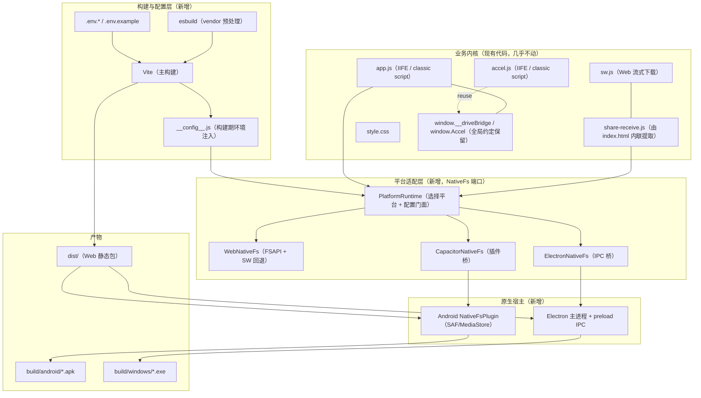
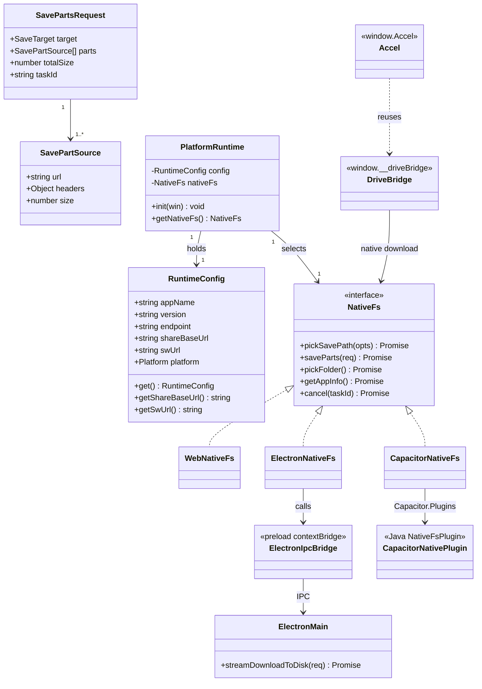
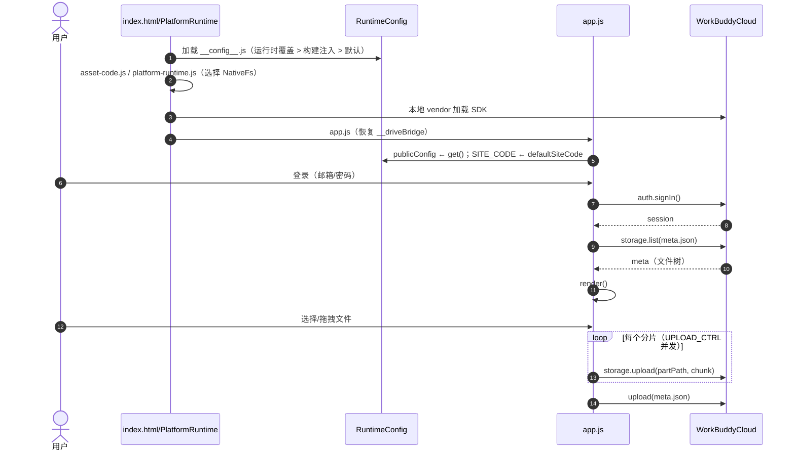
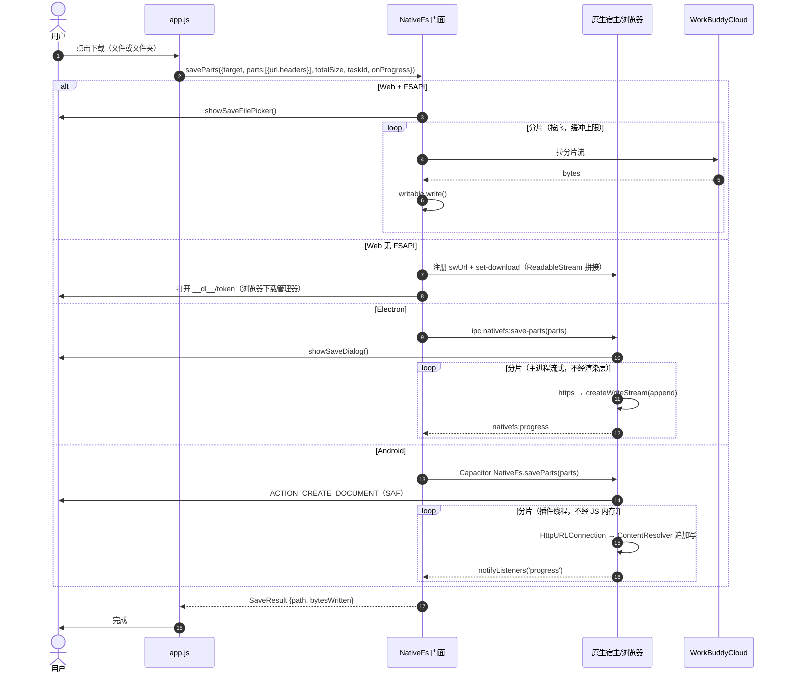
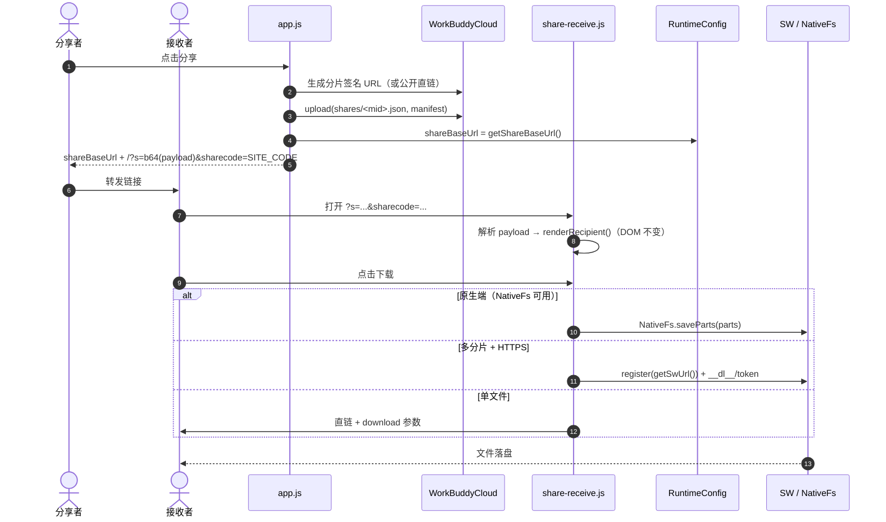
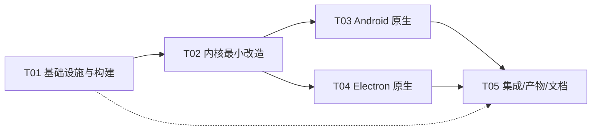
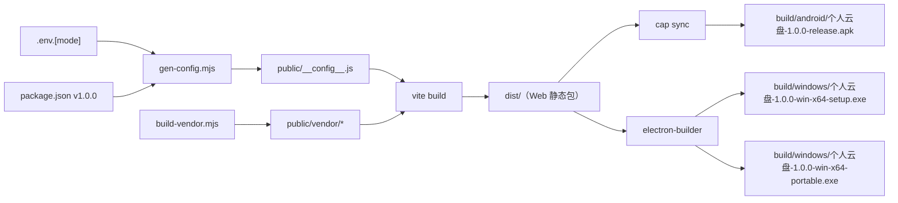

# 个人云盘 · 系统架构设计与任务分解（ARCHITECTURE）

> 文档版本：v1.0 ｜ 作者：架构师 高见远（Gao） ｜ 语言：中文
> 依据：`docs/PRD.md`（增量 PRD v1.0）+ 已核查代码事实（2026-11 基线）
> 核心原则：**最小侵入、保留现有 HTML/CSS/JS 业务内核**；只做"构建层 + 平台适配层 + 配置注入"三件事，不重写业务逻辑、不改成 React 全量重写。

---

## 0. 架构总览（一图看懂）



**一句话**：现有 `app.js`/`accel.js` 保持 classic script 与全局桥梁不变，仅在"读配置、拿分享基址、下载落盘"三个点改调新增的 `PlatformRuntime`/`NativeFs`；三个原生端各自实现 `NativeFs`，构建层用 Vite 注入配置、用 Capacitor/Electron 打包分发。

---

# Part A · 系统设计

## 1. 实现方案与选型

### 1.1 核心技术挑战

| 编号 | 挑战 | 现状证据 | 应对 |
| --- | --- | --- | --- |
| C1 | 业务内核非模块化、强依赖全局符号 | `app.js` 为 IIFE；`window.__driveBridge`（app.js:1937）、`window.Accel`（accel.js 消费）已成型 | 保持 classic script 与全局约定，只新增全局 `window.__DRIVE_CONFIG__` / `window.PlatformRuntime` / `window.NativeFs`，不 ESM 化内核 |
| C2 | 硬编码配置散落 | `app.js:11-21` endpoint/oauthRelay/publishableKey/站点码；`app.js:1434` `location.origin`；`index.html:104` `/sw.js` | 构建期生成 `__config__.js` + 运行时覆盖；分享基址/SW 路径走 `RuntimeConfig` |
| C3 | 三端文件系统能力差异大 | Web 靠 `showSaveFilePicker`（app.js:1130）+ SW；无原生工程 | 抽象 `NativeFs` 端口，三端各自实现；业务层只调接口 |
| C4 | 大文件不得整包进 JS 内存 | >1.5GB 直接拒绝（app.js:1213-1215）；ZIP 打包走 CDN 动态 import（app.js:1466） | 原生端由主进程/插件流式写盘；Web 保留 FSAPI/SW；`client-zip` 本地化 |
| C5 | 绝对路径在原生端失效 | `/sw.js`（index.html:104）、`/__dl__/`（sw.js:23）、`location.origin`（app.js:1434） | SW 路径相对化 + 可配置；原生端不走 SW，走 `NativeFs` |
| C6 | 运行时 CDN 强依赖 | SDK CDN（index.html:346）+ 多源回退（index.html:669-706）；client-zip CDN import | SDK/client-zip 本地 vendor + 打包；多源回退保留为容错 |

### 1.2 技术选型与理由

| 选型 | 版本策略 | 理由 |
| --- | --- | --- |
| **Vite**（主构建） | `^5.4` | 对静态站点/多入口友好；`build.rollupOptions.input` 支持 Web 落地页；`public/` 原样复制便于 vendor 本地化；`define`/构建脚本注入配置；开发体验好 |
| **esbuild**（vendor 预处理） | `^0.24` | 把 `client-zip` 的 ESM 打成 classic IIFE 全局脚本、复制 SDK 到 `public/vendor/`；速度快、配置简单（Vite 内部已依赖 esbuild） |
| **Capacitor**（Android） | `@capacitor/core/cli/android ^6`（以可编译 `targetSdk 36` 的版本为准） | 为现有 Web 应用套原生壳成本最低；Web 内核零重写；插件机制适合实现 NativeFs；`@capacitor/android` 与 Web 共享 dist |
| **Electron**（Windows） | `electron ^31` / `electron-builder ^24` | 桌面端成熟；`contextIsolation + preload + contextBridge` 提供安全最小 IPC；主进程拥有 Node `fs` 可流式写盘；electron-builder 一次产出 NSIS + portable |
| **原生 HTML/CSS/JS 内核** | 保持现状 | PRD 明确不重写；保留 IIFE 与全局桥梁可实现最小侵入 |

> 说明：原生框架用于将同一 Web 内核输出到多端，不是替换内核；`Vite` 与 `esbuild` 职责分离——Vite 管应用构建与配置注入，esbuild 管第三方库本地化预处理。

### 1.3 架构模式

- **端口与适配器（Ports & Adapters / 六边形）**：`NativeFs` 是端口；`WebNativeFs` / `ElectronNativeFs` / `CapacitorNativeFs` 是适配器。
- **运行时门面（Facade）**：`PlatformRuntime` 统一暴露 `config` / `shareBaseUrl` / `swUrl` / `nativeFs`，业务层只依赖它。
- **分层**：内核层（现有）→ 适配层（新增）→ 宿主层（Electron/Android 原生）→ 构建与配置层（横切）。

### 1.4 保留 classic scripts 与全局约定的策略（硬约束）

1. `app.js`、`accel.js`、`share-receive.js`、`sw.js` 全部保持 **classic script / IIFE**，不改为 `type="module"`、不引入 `import`/`export`。
2. 下列全局符号**签名与语义不变**，仅内部实现改为读取新配置：
   - `window.WorkBuddyCloud`（SDK 全局）
   - `window.__driveBridge`（app.js:1937，accel.js 复用同一 SDK 实例/会话/元数据）
   - `window.Accel`（accel.js 暴露的下载任务入口）
   - `window.__ASSET_CODE__`（访问码，供子资源透传）
   - `window.__SHARE_PAYLOAD__` / `renderRecipient()`（分享接收页）
3. 新增全局均为 classic 挂载：`window.__DRIVE_CONFIG__`、`window.__DRIVE_CONFIG_RUNTIME__`、`window.PlatformRuntime`、`window.NativeFs`、`window.electronNativeFs`（仅 Electron preload 注入）。
4. `__driveBridge` 允许**追加**只读引用（如 `config: () => RuntimeConfig.get()`、`nativeFs: () => NativeFs`），不删改既有字段。

### 1.5 index.html 内联分享脚本的拆分策略（DOM 与流程不变）

**目标**：把 `index.html:27-345` 的大段内联脚本抽成 `src/share-receive.js`，`index.html:10-25` 的访问码逻辑抽成 `src/asset-code.js`，其余 DOM（`#recipient-view`、`#login-view`、`#app-view` 等）与 CSS 类保持原样。

**执行时序必须保持一致**（原顺序：访问码 → 分享重定向/接收页 → SDK → app.js → accel.js）：

```html
<!-- head：顺序敏感 -->
<script src="asset-code.js"></script>       <!-- 原 index.html:10-25，定义 __ASSET_CODE__ 并写入 css -->
<script src="__config__.js"></script>        <!-- 新增，构建期生成，定义 __DRIVE_CONFIG__ -->
<script src="platform-runtime.js"></script>  <!-- 新增，初始化 PlatformRuntime / NativeFs -->
<script src="share-receive.js"></script>     <!-- 原 index.html:27-345，逻辑原样搬迁 -->
<script src="vendor/workbuddy-cloud-sdk.js"></script>  <!-- 原 index.html:346 CDN 改本地 -->
<!-- body 末尾：保留原多源回退结构，本地优先 -->
<script src="app.js"></script> → <script src="accel.js"></script>
```

**搬迁时的最小改动清单**（除此之外逐字保留）：

| 原位 | 原写法 | 改为 | 原因 |
| --- | --- | --- | --- |
| index.html:104 | `navigator.serviceWorker.register('/sw.js?v=...')` | `PlatformRuntime.getSwUrl()` + 相对路径 | 分享基址解耦 |
| index.html:119 | `a.href = '/__dl__/' + token` | `PlatformRuntime.getSwUrl()` 推导 `__dl__` 前缀 | 同上 |
| 接收页下载入口 | 仅 SW/直链 | 若 `window.NativeFs` 可用则优先 `NativeFs.saveParts()` | 原生端落盘（DOM/按钮不变） |

> 接收页 DOM 结构、按钮 id（`rc-download`/`rc-sw`/`rc-zip`）、`renderRecipient()` 流程保持不变；仅下载实现内部按平台分流。

---

## 2. 完整文件清单

> 标注：**新建** / **修改** / **生成**（生成项由构建工具产出，建议不直接编辑，必要时纳入 .gitignore 或版本控制见 §8）。

### 2.1 根目录与工程配置

| 文件 | 状态 | 说明 |
| --- | --- | --- |
| `package.json` | 新建 | 名称 `personal-drive`、版本 `1.0.0`（唯一版本源）、scripts、依赖 |
| `package-lock.json` | 生成 | 锁版本，`npm 版本以安装时锁定为准` |
| `vite.config.ts` | 新建 | 多入口构建、`publicDir`、`define`、调用配置生成钩子 |
| `tsconfig.json` | 新建 | 仅用于配置/脚本类型检查与编辑器提示（不编译内核 JS） |
| `capacitor.config.ts` | 新建 | `appId: com.workbuddy.personaldrive`、`appName: 个人云盘`、`webDir: dist`、`android` 配置 |
| `electron-builder.yml` | 新建 | appId/productName/version、win x64 `nsis` + `portable`、目录与图标 |
| `.env.example` | 新建 | 全部环境变量样例（无真实密钥） |
| `.env.development` / `.env.production` | 新建（本地，加入 .gitignore） | 各环境注入值；生产真实值由 CI/运维提供 |
| `.gitignore` | 修改 | 增加 `dist/`、`build/`、`node_modules/`（已有）、`android/.gradle/`、`android/local.properties`、`.env.*`（保留 `.env.example`）、`*.jks`/`*.keystore` |
| `README.md` | 修改 | 去掉"无构建步骤"（原:26），补三端构建/配置/产物说明 |
| `index.html` | 修改 | 内联脚本外链化、脚本加载顺序调整、SDK 改本地（DOM 不变） |
| `app.js` | 修改 | 配置注入（:11-21）、分享基址（:1434）、client-zip 本地化（:1466）、NativeFs 下载（:1126-1225 / :1472）、`__driveBridge` 追加引用（:1937） |
| `accel.js` | 修改（最小/可不动） | 仅在下载落盘点改调 `NativeFs`；保持 `window.Accel` 与 `__driveBridge` 用法 |
| `sw.js` | 修改 | `/__dl__/` 前缀可配置、注册路径相对化；不引入 ESM |
| `style.css` | 修改 | P1：增加响应式断点（现仅一处 640px，:260）与触控友好样式 |

### 2.2 Web 内核与适配层（src/）

| 文件 | 状态 | 说明 |
| --- | --- | --- |
| `src/asset-code.js` | 新建 | 由 index.html:10-25 提取：`window.__ASSET_CODE__` + 访问码透传 + css 写入 |
| `src/config/runtime-config.js` | 新建 | 合并运行时覆盖/构建注入/默认值；`get()`、`shareUrl()`、`getShareBaseUrl()`、`getSwUrl()` |
| `src/platform/nativefs.js` | 新建 | `NativeFs` 门面：`init()` 按平台委托，统一错误包装 |
| `src/platform/nativefs.web.js` | 新建 | Web 实现：FSAPI 边下边写 + SW/Blob 回退（复用 app.js 现有逻辑） |
| `src/platform/nativefs.electron.js` | 新建 | Electron 实现：调用 `window.electronNativeFs` IPC |
| `src/platform/nativefs.capacitor.js` | 新建 | Android 实现：调用 `Capacitor.Plugins.NativeFs` |
| `src/platform/platform-runtime.js` | 新建 | 引导脚本：初始化 `PlatformRuntime`，挂载 `window.NativeFs` |
| `src/platform/errors.js` | 新建 | `NativeFsError` 与错误码常量 |
| `src/share-receive.js` | 新建 | 由 index.html:27-345 提取的公开接收页逻辑 |
| `src/types/config.d.ts` | 新建（可选） | `RuntimeConfig` / `NativeFs` 的 JSDoc 类型声明（编辑器提示） |

### 2.3 构建脚本与本地依赖（scripts/ / public/）

| 文件 | 状态 | 说明 |
| --- | --- | --- |
| `scripts/gen-config.mjs` | 新建 | 读环境变量，生成 `public/__config__.js` |
| `scripts/build-vendor.mjs` | 新建 | esbuild 打包 client-zip 为 IIFE、复制 SDK 到 `public/vendor/` |
| `scripts/build-all.mjs` | 新建 | 编排：gen-config → build-vendor → vite build → cap sync / electron build |
| `scripts/sign-check.mjs` | 新建 | 检查签名材料是否齐备，决定 release 或 unsigned 分支 |
| `public/__config__.js` | 生成 | `window.__DRIVE_CONFIG__ = Object.freeze({...})` |
| `public/vendor/workbuddy-cloud-sdk.js` | 生成 | SDK 本地副本（固定版本，非 `@dev`） |
| `public/vendor/client-zip.global.js` | 生成 | client-zip 的 IIFE 全局（`window.clientZip.downloadZip`） |

### 2.4 Electron 工程（electron/）

| 文件 | 状态 | 说明 |
| --- | --- | --- |
| `electron/main.js` | 新建 | 主进程：窗口、安全策略、IPC 注册、协议导航白名单 |
| `electron/preload.js` | 新建 | `contextBridge.exposeInMainWorld('electronNativeFs', {...})` 最小 API |
| `electron/ipc/file-ipc.js` | 新建 | IPC channel handlers：`pick-save-path`、`save-parts`、`cancel`、`app-info`、`open-external` |
| `electron/file/download-writer.js` | 新建 | 主进程流式下载写盘：`https` 拉分片 → `createWriteStream({flags:'a'})` → 进度回报 |
| `electron/file/path-guard.js` | 新建 | 保存路径校验、目录存在性、覆盖策略 |
| `electron/assets/icon.ico` | 新建 | Windows 图标（占位或正式） |

### 2.5 Android 工程（android/，Capacitor）

| 文件 | 状态 | 说明 |
| --- | --- | --- |
| `android/`（整个目录） | 生成 | `npx cap add android` 生成；纳入版本控制的是 Gradle 配置与源码 |
| `android/app/src/main/java/com/workbuddy/personaldrive/MainActivity.java` | 修改 | `registerPlugin("NativeFsPlugin", new NativeFsPlugin())` |
| `android/app/src/main/java/com/workbuddy/personaldrive/NativeFsPlugin.java` | 新建 | `@CapacitorPlugin` 方法：`pickSavePath`/`saveParts`/`pickFolder`/`cancel`/`getAppInfo` |
| `android/app/src/main/java/com/workbuddy/personaldrive/NativeFsWriter.java` | 新建 | SAF/MediaStore 流式写盘实现 |
| `android/app/src/main/AndroidManifest.xml` | 修改 | 权限与 `android:exported`（见 §8.4） |
| `android/app/build.gradle` | 修改 | `minSdk 26` / `targetSdk 36`、`signingConfigs`、`applicationId` |
| `android/variables.gradle` / `android/build.gradle` | 生成/修改 | SDK 版本、Capacitor 版本统一 |
| `android/app/src/main/assets/public/` | 生成 | `npx cap sync` 复制 `dist/` 到此 |
| `android/keystore/` | 新建（不入库） | release keystore（真实值待确认，见 §10） |

### 2.6 产物与文档

| 目录/文件 | 状态 | 说明 |
| --- | --- | --- |
| `dist/` | 生成 | Web 静态产物（Vite 输出） |
| `build/android/个人云盘-1.0.0-release.apk` | 生成 | Android release APK（签名或 debug 签名降级） |
| `build/windows/个人云盘-1.0.0-win-x64-setup.exe` | 生成 | NSIS 安装包 |
| `build/windows/个人云盘-1.0.0-win-x64-portable.exe` | 生成 | 便携版 |
| `docs/ARCHITECTURE.md` | 新建（本文件） | 架构设计与任务分解 |
| `docs/sequence-diagram.mermaid` | 新建 | 时序图源文件 |
| `docs/class-diagram.mermaid` | 新建 | 类图源文件 |

---

## 3. 数据结构与接口

### 3.1 Runtime Config（运行时配置）

**字段**（`window.__DRIVE_CONFIG__` + `window.__DRIVE_CONFIG_RUNTIME__` 合并结果）：

| 字段 | 类型 | 来源/默认 | 说明 |
| --- | --- | --- | --- |
| `appName` | string | `个人云盘` | 应用名，用于标题与安装包 productName |
| `version` | string | 读 `package.json` → `1.0.0` | 三端统一版本，**唯一来源 package.json** |
| `endpoint` | string | `VITE_ENDPOINT` | 后端地址（禁用硬编码） |
| `oauthRelayBaseUrl` | string | `VITE_OAUTH_RELAY_BASE_URL` | OAuth 中继地址 |
| `publishableKey` | string | `VITE_PUBLISHABLE_KEY` | 公钥/发布密钥 |
| `defaultSiteCode` | string | `VITE_DEFAULT_SITE_CODE` | 默认站点码（原 `PBCKY4YAA5`） |
| `shareBaseUrl` | string | `VITE_SHARE_BASE_URL`，缺省 `location.origin` | 分享链接落地页基址 |
| `swUrl` | string | `VITE_SW_URL`，缺省 `./sw.js` | SW 脚本地址（相对路径） |
| `platform` | `'web' \| 'electron' \| 'android'` | 构建/宿主注入 | 决定 NativeFs 实现 |
| `chunkMb` / `uploadConc` | number | `VITE_CHUNK_MB` / `VITE_UPLOAD_CONC` | 可选，保留现有 localStorage 覆盖逻辑 |
| `cspSources` | object | `VITE_CSP_*` | CSP 白名单（见 §8.5） |

**合并优先级**：`window.__DRIVE_CONFIG_RUNTIME__`（原生端运行时覆盖） > `window.__DRIVE_CONFIG__`（构建期注入） > 内置默认值。

**env 命名规范**：统一 `VITE_` 前缀，仅 `_SCREAMING_SNAKE_CASE`；密钥类不入库、由 CI/运维注入。

### 3.2 NativeFs 接口（端口）

```ts
interface NativeFs {
  pickSavePath(opts: { suggestedName?: string; filters?: { name: string; extensions: string[] }[] }): Promise<SaveTarget>;
  saveParts(req: SavePartsRequest): Promise<SaveResult>;
  pickFolder(): Promise<SaveTarget>;
  readFileSlice(req: { path: string; offset: number; length: number }): Promise<Uint8Array>;
  openExternal(url: string): Promise<void>;
  getAppInfo(): Promise<AppInfo>;
  cancel(taskId: string): Promise<void>;
}

interface SavePartsRequest {
  target: SaveTarget;                 // 目标（pickSavePath/pickFolder 返回）
  parts: SavePartSource[];            // 分片来源：{url, headers?, size?}
  totalSize: number;
  taskId: string;
  onProgress?: (written: number, total: number) => void;
}
```

**关键设计**：`saveParts` 入参是**分片 URL 描述**而非分片字节——由原生宿主（Electron 主进程 / Android 插件）自行流式下载并落盘，渲染层/JS 层完全不接触文件字节，从根本上避免大文件 OOM。Web 实现无原生宿主，退化为现有 FSAPI/SW 路径。

| 方法 | Web 行为 | Electron 行为 | Android 行为 |
| --- | --- | --- | --- |
| `pickSavePath` | `showSaveFilePicker()`（不支持时返回内存目标） | `dialog.showSaveDialog()` | `ACTION_CREATE_DOCUMENT` (SAF) |
| `saveParts` | FSAPI 写盘；无 FSAPI → SW/Blob | 主进程 `https` 流 + 追加写 | 插件线程 `HttpURLConnection` + `ContentResolver` |
| `pickFolder` | 目录 input（webkitdirectory） | `dialog.showOpenDialog({properties:['openDirectory']})` | `ACTION_OPEN_DOCUMENT_TREE` |
| `readFileSlice` | `Blob.slice()` | Node `fs.read` | `ContentResolver` 读（P2） |
| `openExternal` | `window.open` | `shell.openExternal` | `Intent.ACTION_VIEW` |
| `getAppInfo` | 返回 web/version | `app.getVersion()` | `PackageManager.getPackageInfo()` |
| `cancel` | AbortController | 终止请求 + 关闭流 | `HttpURLConnection.disconnect()` |

### 3.3 Electron IPC Channel（preload ↔ 主进程）

> 全部使用 `ipcRenderer.invoke`（请求-响应）+ 主进程 `webContents.send('nativefs:progress', ...)` 推进度；preload 只暴露白名单 API，**不暴露 `ipcRenderer` 本体**。

| Channel | 方向 | 参数 | 返回 |
| --- | --- | --- | --- |
| `nativefs:pick-save-path` | invoke | `{ suggestedName?, filters? }` | `{ canceled: boolean, filePath?: string, name?: string }` |
| `nativefs:pick-folder` | invoke | `{}` | `{ canceled: boolean, filePath?: string }` |
| `nativefs:save-parts` | invoke | `{ target, parts:[{url, headers?, size?}], totalSize, taskId }` | `SaveResult { path, bytesWritten, canceled }` |
| `nativefs:cancel` | invoke | `{ taskId }` | `{ ok: boolean }` |
| `nativefs:app-info` | invoke | `{}` | `{ platform:'electron', version, appName, osVersion }` |
| `nativefs:open-external` | invoke | `{ url }` | `{ ok: boolean }`（主进程校验 URL 白名单） |
| `nativefs:progress` | send（主→渲染） | `{ taskId, written, total }` | —（渲染层 `onProgress` 回调） |

**主进程流式写盘要点**：`https.get(part.url, { headers })` → `res.pipe(createWriteStream(target.filePath, { flags: firstPart ? 'w' : 'a' }))`；逐分片串行保证顺序；累加 `bytesWritten` 推 `nativefs:progress`；`cancel` 时 `req.destroy()` + `stream.end()`。签名 URL 的 `headers` 由渲染层透传（主进程无 CORS 限制）。

### 3.4 Android 插件方法签名（Capacitor）

```java
@CapacitorPlugin(name = "NativeFs")
public class NativeFsPlugin extends Plugin {
  @PluginMethod public void pickSavePath(PluginCall call)   // opts: suggestedName -> {canceled, uri, name}
  @PluginMethod public void saveParts(PluginCall call)      // JSObject: target, parts, totalSize, taskId
                                                            // 后台线程流式下载；notifyListeners("progress", data)
                                                            // 返回 JSObject {path, bytesWritten, canceled}
  @PluginMethod public void pickFolder(PluginCall call)     // -> {canceled, uri, name}（SAF 目录树）
  @PluginMethod public void cancel(PluginCall call)         // {taskId} -> {ok}
  @PluginMethod public void getAppInfo(PluginCall call)     // -> {platform:"android", version, appName, osVersion}
  @PluginMethod public void openExternal(PluginCall call)   // {url} -> {ok}（Intent.ACTION_VIEW）
}
```

- JS 侧调用：`Capacitor.Plugins.NativeFs.saveParts({...})`；进度监听 `Capacitor.Plugins.NativeFs.addListener('progress', cb)`。
- `saveParts` 在 `Executors` 后台线程执行：对每个 part 用 `HttpURLConnection` 拉取，经 `ContentResolver.openOutputStream(treeUri, 'wa')` 追加写（SAF）；大目录/大文件用 `MediaStore.Downloads` 插入记录后写流。
- 需 `bridge.setPermissionCallback` 处理运行时权限；SAF 通过 Intent 授权，通常无需存储权限。

### 3.5 错误对象规范

统一 `NativeFsError`（`src/platform/errors.js`），所有适配层拒绝时抛出该类型：

```js
{
  code: 'E_NATIVEFS_CANCEL' | 'E_NATIVEFS_PERM' | 'E_NATIVEFS_IO'
      | 'E_NATIVEFS_UNSUPPORTED' | 'E_IPC_TIMEOUT' | 'E_NATIVEFS_INVALID_PATH',
  message: '人类可读信息',
  taskId?: '对应任务 ID',
  cause?: '原始异常/错误码'
}
```

| code | 语义 | UI 处理 |
| --- | --- | --- |
| `E_NATIVEFS_CANCEL` | 用户取消 | 静默结束，保留已写部分 |
| `E_NATIVEFS_PERM` | 权限/授权失败 | 提示重新授权 |
| `E_NATIVEFS_IO` | 写盘/网络失败 | 提示重试，显示 `cause` |
| `E_NATIVEFS_UNSUPPORTED` | 平台不支持该能力 | 回退到 Web 路径 |
| `E_IPC_TIMEOUT` | Electron IPC 超时 | 提示重启/重试 |
| `E_NATIVEFS_INVALID_PATH` | 目标路径非法 | 重新选择位置 |

### 3.6 分享 Manifest 规范（兼容现有格式）

```jsonc
// 单文件（现有）
{ "type": "file", "name": "a.zip", "size": 123456, "parts": ["https://...sign", "..."] }
// 文件夹（现有，app.js:1425）
{ "type": "folder", "name": "docs", "files": [
    { "name": "子目录/x.txt", "relPath": "docs/子目录/x.txt", "size": 12, "parts": ["https://..."] }
] }
// 清单引用（分享链接 payload，index.html:27-51）
{ "type": "manifest", "url": "https://.../shares/<mid>.json" }
```

- 分享链接格式：`${shareBaseUrl}/?s=${b64encodeUrl(JSON.stringify(payload))}&sharecode=${SITE_CODE}`（替换 app.js:1434 的 `location.origin`）。
- `parts` 项可为字符串 URL 或 `{url, headers?, size?}`；接收端据此构造 `SavePartSource`。
- **保持向后兼容**：接收页仍支持旧版「单对象直链」的 `location.replace(raw)` 路径。

### 3.7 类图（完整版见 `docs/class-diagram.mermaid`）



---

## 4. 程序调用流程

> 完整时序图见 `docs/sequence-diagram.mermaid`；以下按场景分列。

### 4.1 启动 / 登录 / 列目录 / 上传



### 4.2 下载单文件 / 文件夹（三端分流，核心）



### 4.3 生成分享 → 接收页免登录下载



---

## 5. Anything UNCLEAR（假设与澄清）

| 项 | 假设/处理 |
| --- | --- |
| Capacitor 版本与 `targetSdk 36` | 选能编译 `targetSdk 36` 的 `@capacitor/*` 版本（6.x 或 7.x），以安装时实际支持为准；若当前稳定版不支持 36，先按 35 构建并在 `variables.gradle` 标注，待 SDK 就绪升 36 |
| SDK 固定版本 | 用 `npm view @tencent-ai/workbuddy-cloud-sdk version` 取最新稳定版固定；**禁止 `@dev` 进生产**；vendor 化后与 CDN 多源回退并存 |
| 分享域名/来源白名单 | 未确认前用占位 env 值，构建与开发不阻塞；发送签名 URL 的 `headers` 由 RuntimeConfig 提供扩展位 |
| 接收页在原生 WebView 的 SW 行为 | Capacitor/Electron 内 SW 不可靠，接收页优先走 `NativeFs`；SW 路径作为 Web 端主路径 |
| `app.js` 现有 SW 逻辑与新增 NativeFs 的关系 | 由 `PlatformRuntime.platform` 分流：web 仍用原 FSAPI/SW 代码（最小改动），原生端走 NativeFs；避免两套逻辑互相覆盖 |

---

# Part B · 任务分解

## 6. 依赖包列表（Required Packages）

```text
# 构建与配置
vite@^5.4.0                       : Web 应用构建、配置 define、多入口
esbuild@^0.24.0                   : vendor 预处理（client-zip → IIFE），Vite 已内置但显式声明
typescript@^5.6.0                 : 配置/脚本类型检查与编辑器提示（可选但推荐）
dotenv@^16.4.0                    : scripts 读取 .env 生成 __config__.js
cross-env@^7.0.3                  : 跨平台 npm scripts 环境变量

# Android（Capacitor）
@capacitor/core@^6.0.0            : Capacitor 运行时
@capacitor/cli@^6.0.0             : cap add/sync/build 命令
@capacitor/android@^6.0.0         : Android 平台工程
  （注：以可编译 targetSdk 36 的版本为准，可为 ^7.x；安装时以 lockfile 锁定）

# Windows（Electron）
electron@^31.0.0                  : 桌面运行时（devDependency）
electron-builder@^24.13.0         : 打包 NSIS + portable（devDependency）

# 业务依赖（本地化）
@tencent-ai/workbuddy-cloud-sdk@<固定稳定版本>  : 认证与存储；vendor 化副本，禁用 @dev
client-zip@^2.0.0                 : 文件夹打包；esbuild 打成 public/vendor/client-zip.global.js
```

> **版本说明**：`npm 版本以安装时 `package-lock.json` 锁定为准`；上表为主要版本约束。`@dev` 为开发标签不可用于生产；SDK/client-zip 一律走"本地 vendor + 固定版本"，CDN 多源回退仅作容错，不作为唯一依赖。

---

## 7. 任务列表（按依赖顺序，5 个顶层任务）

> 采用 **5 个顶层任务**（符合任务分解硬上限），每个任务内给出文件级子项（修改对象 + 内容类型），工程师可据此一次性完成。

### T01 · 项目基础设施与构建工程

- **Source Files**：`package.json`、`package-lock.json`、`vite.config.ts`、`tsconfig.json`、`.env.example`、`.env.development`、`.env.production`、`.gitignore`、`scripts/gen-config.mjs`、`scripts/build-vendor.mjs`、`scripts/build-all.mjs`
- **Dependencies**：无
- **Priority**：P0
- **子项**：
  1. `package.json`：初始化（name/version 1.0.0/scripts/deps），scripts 含 `dev`/`build:web`/`build:android`/`build:win`/`build:all`/`gen:config`/`vendor`
  2. `vite.config.ts`：多入口（index.html）、`publicDir:'public'`、`build.outDir:'dist'`、构建前调用 gen-config/build-vendor
  3. `.env.example` + `.env.*`：按 §3.1 列全变量（占位值），无真实密钥
  4. `scripts/gen-config.mjs`：env → `public/__config__.js`（含 version 从 package.json 读取）
  5. `scripts/build-vendor.mjs`：esbuild 打包 client-zip 为 IIFE、复制 SDK 到 `public/vendor/`
  6. `scripts/build-all.mjs`：编排 gen-config → vendor → vite build → cap sync / electron build
  7. `.gitignore`：补 dist/build/.env.*/*.jks 等；`tsconfig.json` 最小配置

### T02 · 内核最小改造：配置注入 + 适配层 + 分享解耦 + SDK 本地化

- **Source Files**：`index.html`、`src/asset-code.js`、`src/share-receive.js`、`src/config/runtime-config.js`、`src/platform/*.js`、`src/platform/errors.js`、`app.js`、`sw.js`、`style.css`、`public/__config__.js`（生成）
- **Dependencies**：T01
- **Priority**：P0
- **子项**：
  1. `src/config/runtime-config.js` + `src/platform/platform-runtime.js` + `errors.js`：实现配置合并、平台选择、`NativeFs` 门面与统一错误
  2. `src/asset-code.js` / `src/share-receive.js`：从 index.html:10-25 / :27-345 原样提取，仅改 §1.5 表格点（swUrl/shareBaseUrl/NativeFs 优先）
  3. `index.html`：脚本顺序改为 §1.5；SDK 改本地 vendor；保留多源回退与全部 DOM
  4. `app.js`：配置注入（:11-21）、分享基址（:1434）、client-zip 本地加载（:1466）、下载分流到 NativeFs（:1126-1225/:1472）、`__driveBridge` 追加 config/nativeFs 引用（:1937）
  5. `sw.js`：`/__dl__/` 前缀可配置
  6. `style.css`（P1）：响应式断点与触控样式（现仅 640px 一处）
  7. `accel.js`（最小）：仅在下载落盘点适配，保持 `window.Accel`

### T03 · Android 原生工程与 NativeFs 插件

- **Source Files**：`capacitor.config.ts`、`android/`（生成与修改）、`android/app/src/main/java/com/workbuddy/personaldrive/{MainActivity,NativeFsPlugin,NativeFsWriter}.java`、`android/app/src/main/AndroidManifest.xml`、`android/app/build.gradle`、`src/platform/nativefs.capacitor.js`
- **Dependencies**：T01、T02
- **Priority**：P0
- **子项**：
  1. `capacitor.config.ts`：appId/appName/webDir:dist/android 配置；`npx cap add android` 生成工程
  2. `NativeFsPlugin.java` / `NativeFsWriter.java`：§3.4 方法，SAF/MediaStore 流式写盘、进度通知、取消
  3. `MainActivity.java`：注册插件；`AndroidManifest.xml`：权限与 `exported`
  4. `build.gradle`：`minSdk 26`/`targetSdk 36`/`applicationId`/`signingConfigs`（占位）
  5. `src/platform/nativefs.capacitor.js`：Capacitor.Plugins 桥接 + 进度监听
  6. 产物：验证 `build/android/个人云盘-1.0.0-release.apk`（签名缺失时用 debug 签名降级，见 §8.6）

### T04 · Windows Electron 工程与 preload IPC

- **Source Files**：`electron/main.js`、`electron/preload.js`、`electron/ipc/file-ipc.js`、`electron/file/download-writer.js`、`electron/file/path-guard.js`、`electron/assets/icon.ico`、`electron-builder.yml`、`src/platform/nativefs.electron.js`
- **Dependencies**：T01、T02
- **Priority**：P0
- **子项**：
  1. `main.js`：窗口、安全配置（contextIsolation/nodeIntegration=false/sandbox）、导航白名单、注册 IPC
  2. `preload.js`：`contextBridge.exposeInMainWorld('electronNativeFs', {...})`，仅暴露 §3.3 白名单，不暴露 ipcRenderer
  3. `ipc/file-ipc.js` + `file/download-writer.js` + `file/path-guard.js`：§3.3 channel 实现，主进程流式下载写盘、进度推送、取消
  4. `src/platform/nativefs.electron.js`：调用 `window.electronNativeFs`，进度回调
  5. `electron-builder.yml`：appId/productName/version=1.0.0、win x64 `nsis` + `portable`、输出目录 `build/windows`
  6. 产物：验证 `build/windows/个人云盘-1.0.0-win-x64-setup.exe` 与 `...portable.exe`

### T05 · 集成联调、产物核验、签名降级与文档

- **Source Files**：`README.md`、`scripts/sign-check.mjs`、`.env.example`、`docs/ARCHITECTURE.md`（本文件）、各端产物目录
- **Dependencies**：T01、T02、T03、T04
- **Priority**：P1
- **子项**：
  1. `README.md`：改"无构建步骤"表述（原:26），补三端构建命令、env 说明、产物路径、安全提示
  2. `scripts/sign-check.mjs`：检测 keystore/证书是否存在，决定 release 签名或 unsigned 分支（见 §8.6）
  3. 三端联调：登录→上传→下载（大文件内存平稳）→分享→接收下载；`grep` 校验无硬编码 endpoint/key/站点码
  4. 产物核验：Web `dist/`、Android APK、Windows NSIS/portable；版本号 1.0.0、应用名一致
  5. 更新 `.env.example` 与架构文档，补齐 CSP/来源白名单配置说明

### 7.1 任务依赖图



---

## 8. 共享知识 / 跨文件约定（Shared Knowledge）

1. **环境变量命名**：统一 `VITE_` 前缀 + 大写下划线；密钥类不入库；`.env.example` 只放占位值；运行时覆盖用 `window.__DRIVE_CONFIG_RUNTIME__`。
2. **构建产物路径**：Web → `dist/`；Android → `build/android/`；Windows → `build/windows/`（均从 `package.json` version 取版本号拼文件名）。
3. **版本号来源**：`package.json.version = 1.0.0` 为**唯一真相源**；Vite define、Capacitor、electron-builder、文件名均由此派生，禁止多处硬编码。`APP_VERSION`（app.js:37）改为从 config 读取（展示用，保留 `v` 前缀）。
4. **全局约定不可破坏**：`window.WorkBuddyCloud` / `window.__driveBridge` / `window.Accel` / `window.__ASSET_CODE__` / `renderRecipient()` 保持签名与语义；新增全局以 `window.__DRIVE_*` / `window.PlatformRuntime` / `window.NativeFs` 命名。
5. **CSP**：
   - Web：Meta/HTTP 头 CSP 需允许 `endpoint`、`oauthRelayBaseUrl`、对象存储域名、`connect-src`/`script-src`；SDK 本地化后 `script-src 'self'` 为主。
   - Electron：`index.html` 设严格 CSP（`default-src 'self'`；`connect-src` 白名单含后端与对象存储），禁 `eval` 与内联脚本（现有 head 内联需外链化后统一）。
6. **Android 权限**：
   - `INTERNET`（必需）；`ACCESS_NETWORK_STATE`（可选）。
   - `targetSdk 36`：分区存储，SAF/MediaStore 无需 `READ/WRITE_EXTERNAL_STORAGE`；若需兼容 ≤28 可条件声明 `maxSdkVersion="28"`。
   - Android 12+ 所有组件必须显式 `android:exported`；`usesCleartextTraffic=false`（强制 HTTPS）。
7. **Electron 安全配置**：`contextIsolation: true`、`nodeIntegration: false`、`sandbox: true`、`webSecurity: true`、`allowRunningInsecureContent: false`；preload 仅暴露最小 API；`will-navigate`/`setWindowOpenHandler` 拦截并交 `shell.openExternal`（校验 URL 白名单）；不启用 `remote`。
8. **CORS / 来源白名单风险**：后端 `endpoint` 与 OAuth relay 必须把以下来源加入白名单——Web 正式域名、Capacitor 的 `http://localhost`（Android）/`capacitor://localhost`（iOS 预留）、Electron 的 `file://` 或自定义 scheme；签名 URL 的自定义 `headers` 由 RuntimeConfig 提供，缺失时分享可能 403（app.js:1447 已提示）。
9. **签名缺失时的降级策略**：
   - Android：无 release keystore → 用 debug 签名产出可安装 APK（仅内部测试，不可上架），文件名标注 `-unsigned`/`-debug`，待真实 keystore 后重签。
   - Windows：无代码签名证书 → electron-builder 产出未签名 NSIS/portable（安装时 SmartScreen 警告），文档标注仅内部测试分发；正式发布需补 EV/OV 证书与时间戳。
   - 降级产物与正式产物分开存放，避免误发。
10. **测试约定**：三端统一验收脚本核对"文件写入大小/哈希一致、下载过程内存平稳、版本号正确、无硬编码密钥"；用 `grep -R` 校验源码。

---

## 9. 构建与产物路径（Build & Artifacts）



| 产物 | 路径 | 签名情形 |
| --- | --- | --- |
| Web 静态包 | `dist/` | 无签名概念；部署到分享域名，HTTPS 必需（SW） |
| Android APK | `build/android/个人云盘-1.0.0-release.apk` | 有 keystore → release 签名；无 → debug 签名降级（文件名标注） |
| Windows NSIS | `build/windows/个人云盘-1.0.0-win-x64-setup.exe` | 有证书 → 签名 + 时间戳；无 → 未签名（SmartScreen 警告） |
| Windows portable | `build/windows/个人云盘-1.0.0-win-x64-portable.exe` | 同上 |

> 文件名由 `productName(个人云盘) + version(1.0.0) + platform/arch` 拼装；`build-all.mjs` 统一编排，失败时明确提示缺失的签名材料。

---

## 10. 待明确事项（仅列真正阻塞最终分发的事项）

| # | 事项 | 影响 | 不阻塞范围 |
| --- | --- | --- | --- |
| 1 | 正式分享域名（`shareBaseUrl`）与后端来源白名单 | 阻塞正式分享链接与签名 URL 的部署 | 开发/构建/三端功能联调用占位 env 可完成 |
| 2 | 生产 `publishableKey` 注入方式与权限边界 | 阻塞生产环境登录/存储 | 开发用测试值；不得入库 |
| 3 | Android release keystore（别名/密码/有效期） | 阻塞 Android 正式上架分发 | 可用 debug 签名 APK 做内部测试 |
| 4 | Windows 代码签名证书（EV/OV、时间戳） | 阻塞 Windows 无警告安装与正式分发 | 可产出未签名 NSIS/portable 做内部测试 |

> 其余（Capacitor 具体版本、SDK 稳定版本号、CSP 细节）由工程师在实现时按安装结果与 §8 约定确定，不构成分发阻塞。

---

**附**：类图与时序图源文件分别为 `docs/class-diagram.mermaid`、`docs/sequence-diagram.mermaid`；本文件内嵌版本为便于阅读的精简呈现，语义一致。
